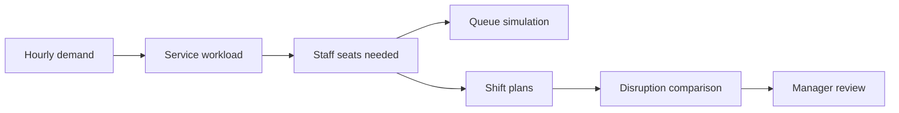

# Apron · FBO Staffing Lab

## Task-first timeline

Mission Control includes the **Service Timeline**. It opens in **Tasks** mode, grouped by arrival assistance, fuel service, and guest assistance. Each aircraft service appears once, even when it requires two workers. Parallel display lanes separate overlapping jobs; they do not represent worker counts. Click a task to inspect its assigned crew, required qualification, service window, and any conflict reason. Use **Crew** for the worker/break view, or **Show uncovered only** to focus on gaps. **Show details** expands the crew view and uncovered-service queue on the same page; **Hide details** collapses them.

## Mission replay window

The selected-day mission replay covers 00:00–24:00. Twelve fictional workers cover three fixed eight-hour shifts: 00:00–08:00, 08:00–16:00, and 16:00–24:00. The same shift repeats each day, giving each worker 16 hours between shifts. Service tasks from late arrivals can finish by 02:00 the next day. Simulator time defaults to 14:00 PST and can be changed in 15-minute steps across the day. The selected time applies when **Run Simulator** is clicked. Arrival delays are capped, and affected service work cannot extend past 02:00. All arrival and staffing data are synthetic assumptions, not VNY operating records or labor rules.

## Dataset

The project includes these data files:

- [synthetic_hourly_demand.csv](backend/data/synthetic_hourly_demand.csv): hour, day, clock, aircraft activity, estimated passengers, estimated fuel requests, and provenance.
- [synthetic_training_history.csv](backend/data/synthetic_training_history.csv): timestamp, hour, weekday, event index, aircraft, passengers, fuel requests, and provenance.
- [synthetic_employees.csv](backend/data/synthetic_employees.csv): fictional worker ID, department qualification, available hours, assumed hourly wage, and provenance.
- [synthetic_requests.csv](backend/data/synthetic_requests.csv): department, arrival minute, service time, and provenance.
- [real_jfk_hourly_departures.csv](backend/data/real_jfk_hourly_departures.csv): timestamp, observed JFK departures per hour, and provenance.
- [aviation-context.ts](frontend/src/lib/aviation-context.ts): LAX commercial airline arrivals by local hour for February 7–13, 2022. The Impact Report displays them as context only; they do not drive demand or staffing.
- [weekly-planner.ts](frontend/src/lib/weekly-planner.ts): browser-only seven-day staffing comparison using fixed-seed synthetic demand and workforce assumptions.

The planner builds its standard hourly profile in code. The synthetic files are generated demo data; they are not records from an FBO. The trained option uses a model fitted to the generated training history.

Most records are synthetic. They do not describe real FBO activity. Low, medium, and high event cases use multipliers of 1.15, 1.4, and 1.7. These are planning assumptions, not forecasts. The LAX reference is commercial airline traffic, not business aviation, FBO demand, or a forecast for 2027. See [data sources](docs/DATA_SOURCES.md).

## How the planner calculates staffing



Demand maps to work: passengers → Passenger Services; aircraft → Ramp Operations; fuel requests → Fuel Services.

**Staff seats per hour** = `ceil(requests × service minutes ÷ 48)`, with department minimums. 48 minutes means one worker at 80% utilization.

Example: 4 aircraft, 18 passengers, 2.6 fuel requests → **2 seats per department**. Demo task times: ramp 24 min, passenger 5 min, fuel 30 min.

The queue uses the selected random seed. Plans use median, 85th percentile, or peak demand. Shift plans use fictional workers, first-available assignment, and configured break, weekly-hour, and rest limits. Both rosters face the same disruption. A manager reviews the result.

## Recovery Planner: proposed staffing

Recovery Planner opens on the current plan: coverage, uncovered services, available crew, labor cost, and task timeline. Click **Plan recovery**, then **View proposed plan** to see the suggested changes. **View current status** returns to the original plan.

For each role, Recovery Planner tries 0–20 additional hypothetical workers against the selected disruption. It recommends the smallest count that covers that role's modeled tasks, or the count covering the most tasks within that limit. The manager can adjust each count; coverage, assignments, and cost recalculate. The page warns when full role coverage is not reached. This bounded search uses the existing greedy scheduler; it does not prove a global optimum.

Added cost assumes the synthetic role rate and a full paid eight-hour shift. The weekly estimate repeats that staffing seven days. Proposed workers and rates need manager validation. A decision record includes the proposed roster, headcounts, and cost estimates; it does not hire, notify, or dispatch workers.

## Data sources

- **Default:** synthetic hourly pattern or a model trained on synthetic history. Scores measure synthetic data only.
- **Optional JFK mode:** observed 2013 airline departures from [nycflights13](https://nycflights13.tidyverse.org/reference/flights.html), scaled as a hypothetical workload. Not arrivals, FBO demand, LA traffic, or VNY data. Passenger and fuel counts are estimates.

More details: [DATA_SOURCES.md](DATA_SOURCES.md).

## Run locally on Windows

Recovery Planner remembers each scenario's disruption, candidate, and review during the current page session. A changed disruption clears its candidate and review; reapplying the same disruption keeps them. Refreshing clears this history.

The current CrewPilot website runs its synthetic mission replay and seven-day staffing plan in the browser. **Only the frontend is required.** The weekly screen compares an ordinary-week roster with low, medium, and high event rosters. It is separate from the optional FastAPI weekly model.

From the project folder, run:

```powershell
.\frontend\run_frontend.cmd
```

Open **http://127.0.0.1:3000**. Keep the terminal running. Press **Ctrl+C** to stop the website.

The launcher installs frontend packages if missing.

If port 3000 is already in use, the website may already be running. Open the URL first, or stop the existing server with **Ctrl+C** before starting another.

### Optional: run the separate backend

The FastAPI backend is a separate weekly staffing model. The browser dashboard runs its own synthetic seven-day plan without a backend connection. To run the FastAPI independently, activate your Python environment, then run:

```powershell
python -m pip install -r backend/requirements.txt
.\backend\run_backend.cmd
```

API documentation: **http://127.0.0.1:8000/docs**. Keep this separate terminal running while using the API.

## Where things live

- [frontend/src/components/operations/command-center.tsx](frontend/src/components/operations/command-center.tsx) — mission pages, controls, charts, and manager review.
- [frontend/src/components/operations/weekly-staffing-plan.tsx](frontend/src/components/operations/weekly-staffing-plan.tsx) — seven-day scenario comparison and manager review.
- [frontend/src/lib/weekly-planner.ts](frontend/src/lib/weekly-planner.ts) — deterministic browser staffing calculation.
- [frontend/src/lib/weekly-review.ts](frontend/src/lib/weekly-review.ts) — day/shift/role differences and reconciliation for the proposal review. The weekly proposal uses fixed peak-staffing rules and greedy worker assignment; it is not a global optimizer.
- [backend/main.py](backend/main.py) — API for simulations, replay, staffing plans, and manager decisions.
- [backend/model.py](backend/model.py) — demand, staffing needs, and waiting-line simulation.
- [backend/scheduling.py](backend/scheduling.py) — synthetic shift roster, break capacity, rest/hour limits, and disruption comparison.
- [backend/training.py](backend/training.py) — train and measure the demo forecast model.
- [backend/data](backend/data) — synthetic input files and trained model.
- [backend/tests](backend/tests) — automated checks.

## API summary

- `POST /api/simulate` — runs the selected demand case and returns the hourly forecast, ordinary-week comparison profile, staffing requirements, plan metrics, provenance, and synthetic holdout report when the trained model is selected.
- `GET /api/scenario-summary` — accepts `multiplier`, `forecast_mode`, `proxy_scale`, and JSON `service_minutes` query parameters; returns ordinary-week totals plus low/medium/high event-week totals, peak activity, and peak concurrent seats by department.
- `POST /api/replay` — returns the seeded request trace for a selected staffing option.
- `POST /api/staffing-plan` — accepts the simulation inputs plus shift length, break minutes, weekly hour cap, rest gap, and disruption settings; builds baseline/event rosters and evaluates both under the same call-outs, arrival surge, and service delay.
- `POST /api/staffing-decisions` — recomputes and saves manager approval or rejection for a staffing roster.
- `POST /api/decisions` — stores a manager's approve/reject decision locally for a simulation snapshot.

Interactive request and response schemas are available at `http://127.0.0.1:8000/docs` while the backend is running.

## Useful commands

Retrain the synthetic demo forecast:

```powershell
python -m backend.training
```

## Terms

- **Staff seat:** one qualified worker available to serve requests at the same time.
- **Baseline:** the simple starting staffing plan.
- **Scenario:** a low, medium, or high demand level.
- **Simulation:** a repeatable test of how requests wait for available staff.
- **Synthetic:** generated example data, not collected from a real FBO.
