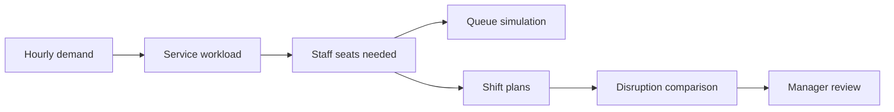

# Apron · FBO Staffing Lab

## Task-first timeline

The operations timeline opens in **Tasks** mode, grouped by arrival assistance, fuel service, and guest assistance. Each aircraft service appears once, even when it requires two workers. Parallel display lanes separate overlapping jobs; they do not represent worker counts. Click a task to inspect its assigned crew, required qualification, service window, and any conflict reason. Use **Crew** for the worker/break view, or **Show uncovered only** to focus on gaps.

## Dataset

The project includes these data files:

- [synthetic_hourly_demand.csv](backend/data/synthetic_hourly_demand.csv): hour, day, clock, aircraft activity, estimated passengers, estimated fuel requests, and provenance.
- [synthetic_training_history.csv](backend/data/synthetic_training_history.csv): timestamp, hour, weekday, event index, aircraft, passengers, fuel requests, and provenance.
- [synthetic_employees.csv](backend/data/synthetic_employees.csv): fictional worker ID, department qualification, available hours, assumed hourly wage, and provenance.
- [synthetic_requests.csv](backend/data/synthetic_requests.csv): department, arrival minute, service time, and provenance.
- [real_jfk_hourly_departures.csv](backend/data/real_jfk_hourly_departures.csv): timestamp, observed JFK departures per hour, and provenance.

The planner builds its standard hourly profile in code. The synthetic files are generated demo data; they are not records from an FBO. The trained option uses a model fitted to the generated training history.

Most records are synthetic. They do not describe real FBO activity. Low, medium, and high event cases use multipliers of 1.15, 1.4, and 1.7. These are planning assumptions, not forecasts.

## How the planner calculates staffing



Demand maps to work: passengers → Passenger Services; aircraft → Ramp Operations; fuel requests → Fuel Services.

**Staff seats per hour** = `ceil(requests × service minutes ÷ 48)`, with department minimums. 48 minutes means one worker at 80% utilization.

Example: 4 aircraft, 18 passengers, 2.6 fuel requests → **2 seats per department**. Demo task times: ramp 24 min, passenger 5 min, fuel 30 min.

The queue uses the selected random seed. Plans use median, 85th percentile, or peak demand. Shift plans use fictional workers, first-available assignment, and configured break, weekly-hour, and rest limits. Both rosters face the same disruption. A manager reviews the result.

## Recovery Planner: proposed staffing

For each recovery scenario, the planner searches additional Ramp, Fuel, and Customer Service headcount and starts each control at the smallest count that covers that role's modeled tasks when possible. If 100% role coverage cannot be reached within the 20-worker control limit, it selects the headcount that covers the most tasks and reports the remaining gap. A manager can adjust the number controls; each change recalculates the candidate schedule, coverage, and uncovered tasks using the same task scheduler. Counts are saved with the scenario in the current page session, and changing a count clears any previous manager decision.

The page shows added cost for the selected 11:30–20:30 shift/day and a weekly estimate that repeats the same staffing seven times. Costs use the synthetic role hourly rate and full nine-hour paid shift (including its paid break). They are planning estimates, not payroll quotes. Proposed hires are not available for a current incident until a manager hires and schedules them. A decision record includes the proposed worker roster, headcounts, and cost estimates.

## Data sources

- **Default:** synthetic hourly pattern or a model trained on synthetic history. Scores measure synthetic data only.
- **Optional JFK mode:** observed 2013 airline departures from [nycflights13](https://nycflights13.tidyverse.org/reference/flights.html), scaled as a hypothetical workload. Not arrivals, FBO demand, LA traffic, or VNY data. Passenger and fuel counts are estimates.

More details: [DATA_SOURCES.md](DATA_SOURCES.md).

## Run locally on Windows

Recovery Planner remembers each scenario during the current page session. Switching Low/Medium/High, mission day, or demand profile restores that scenario's disruption settings, recovery candidate and review. New conditions require a new calculation; applying a changed disruption clears that scenario's candidate and review. Reapplying identical disruption settings preserves them. Refreshing or closing the page clears this in-memory scenario history; downloaded decision records remain separate.

The current CrewPilot website runs its synthetic demo in the browser. **Only the frontend is required.**

From the project folder, run:

```powershell
.\frontend\run_frontend.cmd
```

Open **http://127.0.0.1:3000**. Keep the terminal running. Press **Ctrl+C** to stop the website.

The launcher installs frontend packages if missing.

If port 3000 is already in use, the website may already be running. Open the URL first, or stop the existing server with **Ctrl+C** before starting another.

### Optional: run the separate backend

The FastAPI backend contains the weekly staffing model. It is **not connected to the current dashboard**. To run its API independently, activate your Python environment, then run:

```powershell
python -m pip install -r backend/requirements.txt
.\backend\run_backend.cmd
```

API documentation: **http://127.0.0.1:8000/docs**. Keep this separate terminal running while using the API.

## Where things live

- [frontend/src/main.tsx](frontend/src/main.tsx) — pages, controls, charts, and manager review.
- [frontend/src/DepartmentView.tsx](frontend/src/DepartmentView.tsx) — animated request and staff-seat replay.
- [backend/main.py](backend/main.py) — API for simulations, replay, staffing plans, and manager decisions.
- [backend/model.py](backend/model.py) — demand, staffing needs, and waiting-line simulation.
- [backend/scheduling.py](backend/scheduling.py) — synthetic shift roster, break capacity, rest/hour limits, and disruption comparison.
- [backend/training.py](backend/training.py) — train and measure the demo forecast model.
- [backend/data](backend/data) — synthetic input files and trained model.
- [backend/tests](backend/tests) — automated checks.

## API summary

- `POST /api/simulate` — runs the selected demand case and returns the hourly forecast, ordinary-week comparison profile, staffing requirements, plan metrics, provenance, and synthetic holdout report when the trained model is selected.
- `GET /api/scenario-summary` — accepts `multiplier`, `forecast_mode`, `proxy_scale`, and JSON `service_minutes` query parameters; returns ordinary-week totals plus low/medium/high event-week totals, peak activity, and peak concurrent seats by department.
- `POST /api/replay` — returns the seeded request trace for a selected staffing option.
- `POST /api/staffing-plan` — accepts the simulation inputs plus shift length, break minutes, weekly hour cap, rest gap, and disruption settings; builds baseline/event rosters and evaluates both under the same call-outs, arrival surge, and service delay.
- `POST /api/staffing-decisions` — recomputes and saves manager approval or rejection for a staffing roster.
- `POST /api/decisions` — stores a manager's approve/reject decision locally for a simulation snapshot.

Interactive request and response schemas are available at `http://127.0.0.1:8000/docs` while the backend is running.

## Useful commands

Retrain the synthetic demo forecast:

```powershell
python -m backend.training
```

## Terms

- **Staff seat:** one qualified worker available to serve requests at the same time.
- **Baseline:** the simple starting staffing plan.
- **Scenario:** a low, medium, or high demand level.
- **Simulation:** a repeatable test of how requests wait for available staff.
- **Synthetic:** generated example data, not collected from a real FBO.
